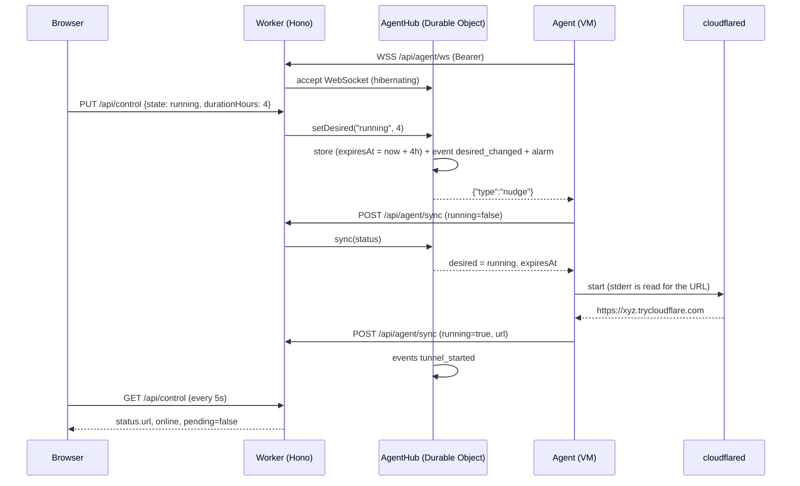

# Architecture

```
Browser (admin)
   │  HTTPS (session cookie), SWR polling every 5s
   ▼
Cloudflare Worker (tunnel-control.<subdomain>.workers.dev)
   ├── static assets: Vite + React SPA (public, no secrets)
   └── /api/* (Hono) ──► Durable Object "AgentHub" (one per agentId, SQLite)
   ▲      ▲                - desired state, last status, events (capped at 100)
   │      │                - the agent's WebSocket (Hibernation API), nudges
   │      │                - alarm for offline detection
   │      │  WSS /api/agent/ws (Bearer): server → agent {"type":"nudge"}
   │  HTTPS POST /api/agent/sync (Bearer): request = status, response = desired
   │
Python agent on the VM (systemd)
   │  subprocess
   ▼
cloudflared tunnel --url http://localhost:8080 ──► Cloudflare edge ──► https://*.trycloudflare.com
   │
   ▼
Demo app on 127.0.0.1:8080

GitHub (push to main) ──► GitHub Actions: build ──► wrangler deploy (Worker + assets + secrets)
```

## Design rules

- **Desired state, not commands.** The UI writes `desired = running | stopped`; the agent makes reality match on every sync. Safe to repeat; survives missed messages; a crashed tunnel is restarted.
- **One round trip per sync.** The agent POSTs its status; the response contains the desired state.
- **The WebSocket is an optimization.** It only triggers an early sync. Without it, the agent polls every 60s.
- **The server owns time.** `lastSeen` is set by the Worker.
- **Online** means `now - lastSeen < AGENT_OFFLINE_AFTER_SECONDS` (default 150s = 2.5 × the poll interval). A Durable Object alarm records the `agent_offline_detected` event at the right moment.
- **The control plane is never exposed through the tunnel.** The agent has no HTTP server; the tunnel forwards only to the demo app.
- **Sessions.** Starting needs a session length (1, 2, 4, 8 or 12 hours). The Durable Object stores `expiresAt`, an alarm (and a check on every read/sync) stops the session when time is up, and the agent also enforces the deadline locally, so a lost connection cannot leave the tunnel open.
- **One page.** Login is a state of `/` (locked/unlocked), not a route.

## Click to tunnel



Polling fallback: the same flow without the `nudge`. The agent's next scheduled sync (≤ 60s) picks up the new desired state.

## Failure modes

| Failure | Behavior |
|---|---|
| Control API unreachable | The agent keeps the tunnel in its current state, logs a warning, retries on the next tick. |
| WebSocket down | The agent reconnects with backoff (5s to 5min); meanwhile it polls. |
| Session time is up | The alarm sets desired to `stopped`, logs `session_expired` and nudges; the agent stops the tunnel (and does so on its own clock if the API is unreachable). |
| `cloudflared` crashes | The next tick sees `running=false`, desired is `running`: it restarts it (with backoff after failed starts: 60s, 120s, 240s, then 300s). |
| Wrong `AGENT_TOKEN` | The agent logs an error with a hint and keeps retrying at the normal interval; it does not crash-loop. |
| Agent stops | The alarm fires at `lastSeen + 150s`: the UI shows offline and an `agent_offline_detected` event is logged. |
| VM reboot | systemd starts the services; the agent syncs and restarts the tunnel if desired is `running`. |
| Worker redeploy | State lives in the Durable Object and survives; the WebSocket reconnects. |

See also: [api.md](api.md), [security.md](security.md), [decisions/](decisions/).
